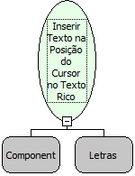

Descrição:

Insere um texto na posição do cursor em um Texto Rico

Parâmetros:

1. Componente Texto Rico

2. Texto em HTML a ser inserido (Letras).

Retorno:

Não possui

Observação:

Para utilizar esta função no Internet Explorer, deve-se previamente utilizar a função "Monitorar posição do cursor no Texto Rico".

Nome Real:

ebfRichTextInsertTextAtPosition

Compatibilidade:

Cliente
