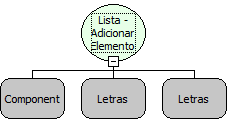

Descrição:

Essa função Insere um elemento no componente Lista. Passando como parâmetro o componente Lista, o valor chave (que será o valor à ser salvo no banco) e o valor que representará o valor chave.

Parâmetros:

1. Nome do componente Lista

2. Valor Chave (Letras)

3. Valor que representará a chave (Letras)

Retorno:

O retorno será o valor inserido no componente Lista

Observação:

O campo chave deve obrigatóriamente ser do tipo Letras. Caso contrário, a lista não irá exibir os valores.

Exemplo:

Assumindo o 1º parâmetro: Carros(Lista) contendo os elementos 1 - Usado e 2 - Novo, sendo 1 e 2 o valor chave e "Usado e Novo" o valor que representam o valor chave. O 2º parâmetro sendo 3 e o 3º parâmetro sendo "Quebrado". O retorno será a lista Carros contendo os elementos 1 - Usado, 2 - Novo e 3 - Quebrado.

Nome Real:

ebfComboPut

Compatibilidade:

Todas as camadas
