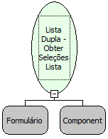

Descrição:

Retorna uma lista com os valores dos campos chaves selecionados dos itens da lista de selecionados do componente lista dupla.

Parâmetros:

1. Formulário que contém a Lista Dupla

2. Componente do tipo Lista Dupla

Retorno:

(Variante) Retorna uma Lista com os selecionados da lista principal

Nome Real:

ebfDualListGetRightSelectedValues

Compatibilidade:

Cliente
