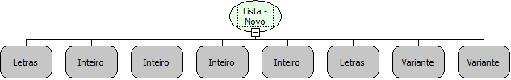

Descrição:

Cria um novo componente Lista de forma dinâmica.

Parâmetros:

1. Aba (Caso não seja definida, a aba será criada).

2. Posição X no formulário.

3. Posição Y no formulário.

4. Largura do componente.

5. Altura do componente.

6. Descrição do Componente.

7. Lista de valores. (Campo Chave)

8. Lista de descrição a ser exibido. (Campo Lista)

Retorno:

Não Possui.

Observação:

As listas podem conter um ou mais elementos, e irão se referenciar uma com a outra de acordo com a posição delas na lista.

Nome Real:

ebfComboBoxNew

Compatibilidade:

Cliente
