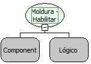

# Moldura - Habilitar com componentes Internos

Descrição:

Esta função habilita ou não o componente moldura e todos os componentes que estiverem "dentro" da área do mesmo.

Parâmetros:

1. Moldura

2. Valor lógico que habilita ou desabilita os componentes.

Retorno:

Não possui.

Nome Real:

ebfGroupBoxEnabledComponents

Compatibilidade:

Cliente
