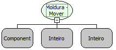

Descrição:

Esta função move o componente moldura e todos os componentes que estiverem "dentro" da área do mesmo.

Parâmetros:

1. Moldura (Componente)

2. Posição X.

3. Posição Y.

Retorno:

Não possui.

Observações:

1. Esta função não move o componente Lista Dupla.

2. Esta função simula a funcionalidade de um Region (container)

Nome Real:

ebfGroupBoxMoveComponents

Compatibilidade:

Cliente
