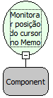

Descrição:

Inicia o monitoramento do deslocamento do cursor dentro de um campo do tipo Memo

Parâmetros:

1. Componente (Letras)

Retorno:

Não possui.

Observações:

1. Esta função monitora apenas o posicionamento do cursor em um componente MEMO

2. Esta função não funciona para o memo quando a propriedade texto rico está setada como "HTML Básico" ou "HTML Avançado".

Nome Real:

freTextAreaMonitorarCursor

Compatibilidade:

Cliente
