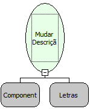

Descrição:

Muda a descrição do componente escolhido no primeiro parâmetro.

Parâmetros:

1. Componente

2. Nova Descrição.

Retorno:

Não possui.

Nome Real:

ebfChangeDescription

Compatibilidade:

Cliente e Servidor
