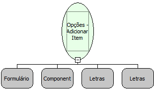

Descrição:

Função que adiciona um item ao componente Opções passado como parâmetro.

Parâmetros:

1. Formulário

2. Componente (Componente Opções)

3. Valor (Referente ao item adicionado)

4. Label (Nome que aparecerá)

Retorno:

Não possui.

Observação:

Ao adicionar item ao componente dinamicamente, não é possível salvar a opção selecionada no banco.

Nome Real:

ebfRadioGroupAdd

Compatibilidade:

Cliente
