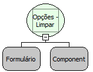

Descrição:

Função que remove todos os itens do componente Opções (RadioGroup).

Parâmetros:

1. Formulário.

2. Componente.

Retorno:

Não possui.

Nome Real:

ebfRadioGroupClean

Compatibilidade:

Cliente
