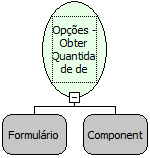

Descrição:

Função que retorna a quantidade itens de um componente Opções

Parâmetros:

1. Formulário onde se encontra o componente

2. Componente Opções

Retorno:

Retorna a quantidade de items do componente (Inteiro)

Nome Real:

ebfRadioGroupGetSize

Compatibilidade:

Cliente
