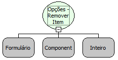

Descrição:

Função que remove um item do componente Opções tomando o índice como referência.

Parâmetros:

1. Formulário

2. Componente

3. Índice do item a ser removido (O Primeiro é 0)

Retorno:

Não possui.

Observação:

O índice dos items estão na ordem N-1.

Nome Real:

ebfRadioGroupRemoveItem

Compatibilidade:

Cliente
