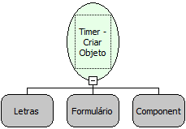

Descrição:

Esta função cria um novo objeto Temporizador, recebe como parâmetro o nome do temporizador, que será usado nas funções de iniciar, pausar, parar e zerar. Recebe ainda, o Formulário e o componente do tipo caixa de texto no qual este  temporizador será constantemente atualizado.

Parâmetros:

1. Nome do Temporizador (Letras)

2. Formulário onde está localizado um componente a ser utilizado pelo Timer.

3. Componente. (Caixa de Texto, Label, etc..)

Retorno:

Retorna a referência do timer. (Variante)

Exemplo:

1º Parâmetro : temporizador (letras)

2º Parâmetro : Cadastro de Tempo

3º Parâmetro : tempo.

Neste exemplo, o edit com nome tempo do Formulário Cadastro de Tempo irá constantemente ser atualizado com o valor do temporizador criado.

Nome Real:

ebfTimerCreate

Compatibilidade:

Cliente
