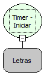

Descrição:

Inicia a contagem no temporizador passado como parâmetro.

Parâmetros:

1. Nome do Temporizador. (Timer)

Retorno:

Não possui.

Observação:

O Temporizador deve ter sido criado anteriormente.

Nome Real:

ebfTimerStart

Compatibilidade:

Cliente
