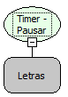

Descrição:

Pausa ou Continua a contagem no temporizador passado como parâmetro.

Parâmetros:

1. Nome do Temporizador. (Timer)

Retorno:

Não possui.

Observação:

Caso o timer ja esteja pausado e a função seja novamente chamada, o contador irá continuar de onde parou.

Nome Real:

ebfTimerPause

Compatibilidade:

Cliente
