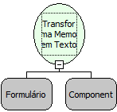

Descrição:

Recebe um componente memo e transforma em texto rico.

Parâmetros:

1. Formulário onde está localizado o componente Memo.

2. Componente memo.

Retorno:

Não possui.

Nome Real:

ebfConvertRichText

Compatibilidade:

Cliente
