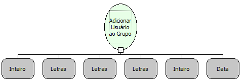

Descrição:

Define a permissão de grupo de usuários. Se o usuário informar o grupo o sistema a função retorna o código do grupo,

senão informar o grupo o sistema cria um grupo e retorna seu codigo.

Parâmetros:

1. Informa o código do grupo.

2. Informa o login do usuário.

3. Informa o nome do usuário.

4. Informa o tipo de expiração da senha.

5. Informa a quantidade de dias de expiração.

6. Informa a data que iniciou o login do usuário.

Retorno:

Controle de acesso do usuário adicionando ao grupo;

Observação:

4º parâmetro:

Colocar:

"E" - se a senha expira em quantidades de dias determinada.

"T" - se a senha é forçada a ser alterada em quantidade de dias especifica.

"I" - se a senha nunca expira

A função cria o usuário para a sessão e não no banco de dados.

Esta função deve ser utilizada no evento "Ao Entrar" do sistema.

Nome Real:

ebfAddUserPermission

Compatibilidade:

Banco de dados e Servidor
