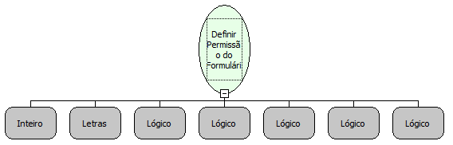

# Definir Permissão do Formulário

Descrição:

Define a permissão de acesso do formulário para um ou mais  grupos de usuários.

Parâmetros:

1. Informa o código do grupo.

2. Informa o nome do formulário.

3. Informa o estado do formulário (visível  ou Invisível).

4. Informa se tem permissão de escrita.

5. Informa se o formulário deve ser habilitado.

6. Informa se tem permissão de Alteração.

7. Informa se tem permissão de Exclusão.

Retorno:

Não possui.

Observação:

3º ao 4º parâmetro:

Colocar:

"True" - se for Verdadeiro (Ex.: Visível)

Ou

"False" - se for Falso (Ex.: Invisível)

Nome Real:

ebfDefineFormPermission

Compatibilidade:

Banco de dados e Servidor
