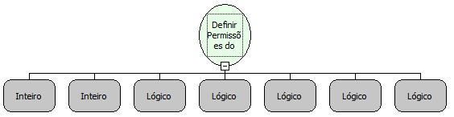

Descrição:

Define a permissão de acesso ao menu para um ou mais grupos de usuários.

Parâmetros:

1. Código do Grupo.

2. Código do Menu (Pode ser obtido através da tabela fr_menu)

3. Estado do menu (Visível ou Invisível).

4. Permissão de escrita.

5. Menu deve ser Habilitado?

6. Permissão de Alteração.

7. Permissão de Exclusão.

Retorno:

Não possui

Nome Real:

ebfDefineMenuPermission

Compatibilidade:

Banco de dados e Servidor
