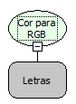

Descrição:

Converte a cor para o formato RGB.

Parâmetros:

1. Cor, exemplo clBlue.

Retorno:

Cor em RGB.

Observações:

O formato RGB é uma forma utilizada para se reproduzir diversas cores através das cores básicas iniciais vermelho (Red), verde (Green) e azul (Blue). Em computação utiliza-se muito esse padrão para se definir uma cor a ser mostrada na tela, se representa a cor RGB em números tendo cada cor, vermelho (R), verde (G) e azul (B) 256 combinações possíveis de 0 a 255 sendo 0 a ausência de dessa cor e 255 a sua plenitude. Sendo Representado da seguinte forma:

- Branco como é o conjunto de todas as cores sendo representado como 255 255 255.
- Preto como sendo a ausência de cores sendo representado com  0 0 0.
- Vermelho, representado como 255 0 0.
- Verde,  representado como 0 255 0.
- Azul representado como  0 0 255.

Exemplos:

1. Assumindo como parâmetro "clGreen", o retorno será #008000.

2. Assumindo como parâmetro "clPurple", o retorno será "#800080".

Nome Real:

ebfDelphiColorToRGB

Compatibilidade:

Todas as camadas
