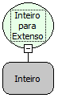

Descrição:

Escreve por extenso um numero passado como parâmetro.

Parâmetros:

1. Número inteiro

Retorno:

Um texto do número passado como parâmetro escrito por extenso (letras)

Exemplo:

Assumindo como parâmetro  123 o retorno será "cento e vinte e três"

Observação:

O valor máximo a ser escrito por extenso é de 999.999.999.999

Nome Real:

ebfIntToString

Compatibilidade:

Servidor
