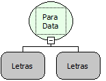

Descrição:

Converte para data o valor passado no primeiro parâmetro. O segundo parâmetro é opcional, e por ele pode-se informar o formato da data que será retornada (válido apenas para fluxo servidor).

Parâmetros:

1. Valor a ser convertido

2. Formato do parâmetro a ser convertido. (OPCIONAL, válido apenas para fluxo servidor)

Retorno:

Valor convertido para data.

Exemplo:

Assumindo como parâmetros a data 10/10/2007 09:12:40 e  o formato dd/MM/yyyy,  o retorno será 10/10/2007 00:00:00.

Observações:

1. O formato da Data referente ao segundo parâmetro deve ser escrito no seguinte formato:

         dd    - Para dia do mês da data do primeiro parâmetro.

         MM  - Para Mês do Ano da data do primeiro parâmetro.

        yyyy  - Para o Ano da data do primeiro parâmetro.

2. O formato da data não remove as horas.

Nome Real:

toDate

Compatibilidade:

Todas as camadas
