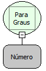

Descrição:

Converte um valor em "radianos" para grau.

Parâmetros:

1. Valor em radianos a ser convertido.

Retorno:

"Radianos" convertido para "Graus". (Número)

Nome Real:

toDegrees

Compatibilidade:

Todas as camadas
