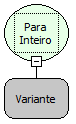

Descrição:

Converte um valor passado por parâmetro para inteiro.

Parâmetros:

1. Valor a ser convertido.

Retorno:

Valor convertido para Inteiro.

Exemplo:

Assumindo como parâmetros "12,54"  ,  o retorno será 12.

Nome Real:

toLong

Compatibilidade:

Todas as camadas
