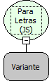

Descrição:

Converte para o formato Texto removendo os caracteres especiais de JavaScript.

Parâmetros:

1. Texto JavaScript para ser convertido para o formato de texto normal.

Retorno:

Texto passado por parâmetro convertido para o formato de texto normal.

Exemplo:

Assumindo como parâmetro o conteúdo "", o retorno será "\r", pois " " é um caractere especial JavaScript.

Nome Real:

ebfToJSString

Compatibilidade:

Todas as camadas
