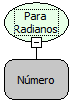

Descrição:

Converte um valor em "graus" para radiano.

Parâmetros:

1. Grau a ser convertido.

Retorno:

Grau convertido para radianos. (Número)

Nome Real:

toRadians

Compatibilidade:

Todas as camadas
