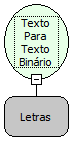

Descrição:

Converte um Texto Normal para um Texto Binário.

Parâmetros:

1. Texto normal em letras.

Retorno:

Texto Binário.

Exemplo:

Assumindo como parâmetro o texto ALL, o retorno será o texto binário "010000010100110001001100".

Nome Real:

ebfAsciiToBinary

Compatibilidade:

Todas as camadas
