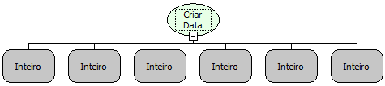

Descrição:

Cria uma data a partir da passagem do ano, mês, dia, hora, minuto e segundo.

Parâmetros:

1. Ano

2. Mês

3. Dia

4. Hora (De 0 a 23)

5. Minuto (De 0 a 59)

6. Segundo (De 0 a 59)

Retorno:

Retorna a data criada.

Exemplo:

Criar Data(2007,5,11,11,5,20)

Retorno "11/05/2007 11:05:20"

Nome Real:

ebfCreateDate

Compatibilidade:

Cliente e Servidor
