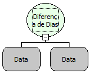

Descrição:

Essa função calcula a diferença de dias (levando em consideração as horas) entre as datas passadas por parâmetros.

Parâmetros:

1. Primeira Data

2. Segunda Data

Retorno:

Retorna a diferença de dias da data do 1º parâmetro com a data do 2º parâmetro.

Exemplos:

1. Assumindo que o 1º parâmetro seja 09/02/2005 00:00:00 e o 2º parâmetro 11/03/2005 00:00:00. O retorno será -30.

2. Assumindo que o 1º parâmetro seja 11/03/2004 00:00:00 e o 2º parâmetro 09/02/2004  00:00:00. O retorno será 30.

Nome Real:

ebfDateDayDifference

Compatibilidade:

Cliente e Servidor
