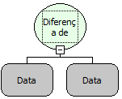

Descrição:

Essa função calcula a diferença de meses entre as datas passadas por parâmetros.

Parâmetros:

1. Primeira Data

2. Segunda Data

Retorno:

Retorna a diferença de meses da data do 1º parâmetro com a data do 2º parâmetro. O retorno pode ser atribuído a uma variável do tipo inteiro.

Exemplos:

1. Assumindo que o 1º parâmetro seja 09/02/2005 e o 2º parâmetro 11/03/2005. O retorno será -1.

2. Assumindo que o 1º parâmetro seja 11/03/2004 e o 2º parâmetro 09/02/2004. O retorno será 30.

Nome Real:

ebfDateMonthDifference

Compatibilidade:

Cliente e Servidor
