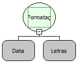

Descrição:

Essa função modifica a formatação da data passada no primeiro parâmetro para a formatação passada no segundo parâmetro.

Tipos de formatos:

yyyy - ano

MM - mês

w - semana do ano (soma das semanas (Somente camada servidor)).

W - semana do mês (soma das semanas (Somente camada servidor)).

D - dia do ano (soma dos dias)

dd - dia do mês (Somente camada servidor).

F - dia da semana (soma dos dias (Somente camada servidor)).

a - am/pm

H - hora (0 a 23h)

k - hora (1 a 24h)

K - hora (0 a 11h am/pm)

h - hora (1 a 12 am/pm)

mm - minutos da hora

ss - segundos hora

SSS - milisegundos da hora (Somente camada servidor).

Parâmetros:

1. Data que deseja formatar

2. Formatação da data

Retorno:

Retorna a data com a nova formatação.

Exemplos:

1. Assumindo que o 1º parâmetro seja 01/04/2007 20: 32: 16, o 2º Parâmetro sendo dd/MM/yyyy K a, o retorno será 01/04/2007 8 PM.

2. Assumindo que o 1º parâmetro seja 01/04/2007 20: 32:16, o 2º Parâmetro sendo dd/MM k:mm, o retorno será 01/04/2007 20:32

Nome Real:

ebfLastDay

Compatibilidade:

Servidor
