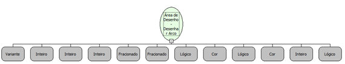

Descrição:

Desenha um arco na área de desenho passada como parâmetro.

Parâmetros:

1. Área de Desenho

2. Coordenada X inicial.

3. Coordenada Y inicial.

4. Raio.

5. Valor do ângulo inicial em graus.

6. Valor do ângulo final em graus.

7. Valor lógico que informa se o arco será preenchido.

8. Cor de preenchimento.

9. Valor lógico que informa se o arco será delineado.

10. Cor da borda.

11. Espessura da borda.

12. Valor lógico que informa se o arco será desenhado no sentido anti-horário.

Retorno:

Não possui.

Nome Real:

ebfCanvasDrawArc.

Compatibilidade:

Cliente.
