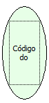

Descrição:

A função retorna o código do formulário chamado no fluxo.

Parâmetros:

Não Possui.

Retorno:

Retorna o código do formulário que chama o fluxo (Letras ou Inteiro).

Exemplo:

Assumindo que o formulário "Cadastro"  chama o fluxo, o retorno seria 9 (inteiro - Código do formulário "Cadastro").

Nome Real:

ebfGetFormID

Compatibilidade:

Cliente e Servidor
