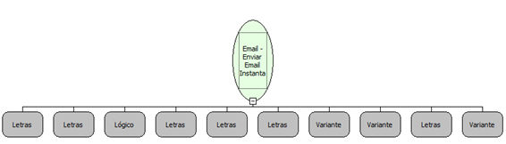

Descrição:

Envia uma mensagem instantaneamente para os destinatários. (Função Depreciada. Utilizar a função "Email - Enviar Email com Anexo").

Parâmetros:

1. Servidor

2. Porta

3. SSL

4. Usuário

5. Senha

6. Remetente

7. Destinatários (Ver Observação 1)

8. Assunto

9. Corpo da mensagem

10. Lista de anexos (Ver Observação 2)

Observações:

1. Os destinatários podem ser passados separados por "," e serão enviados como "TO". Se for necessário enviar email como "TO", "CC" e/ou "BCC", é necessário utilizar a função "Email - Criar lista de destinatários".

2. Para passar apenas um anexo, é possível passar apenas o caminho do arquivo. Se for preciso passar vários anexos, é necessário passar uma lista de caminhos dos arquivos.

Nome Real:

ebfSMTPSendMailInstantly

Compatibilidade:

Servidor
