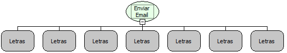

Descrição:

Envia um e-mail para um destinatário passado como parâmetro. (Função Depreciada. Utilizar a função "Email - Enviar Email Instantâneamente").

Parâmetros:

1. Servidor de E-mails.

2. Usuário do e-mail.

3. Senha do e-mail.

4. Remetente.

5. Destinatário.

6. Assunto.

7. Corpo da Mensagem.

Retorno:

Não possui.

Exemplo:

Passando como parâmetros:

1º: mail.softwell.com.br

2º: comercial@softwell.com.br

3°:1234 (Senha)

4°: Comercial

5°: paula@softwell.com.br

6°: Informações sobre o Maker

7°: Seu e-mail foi recebido com sucesso. Obrigado!

Nome Real:

ebfSendMail

Compatibilidade:

Servidor
