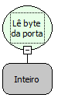

Descrição:

Lê um byte de uma porta especificada.

Parâmetros:

1. Corresponde ao número da porta serial.

Retorno:

Inteiro. (Retorna o byte lido)

Nome Real:

ebfInPort

Compatibilidade:

Cliente
