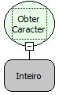

Descrição:

Esta função foi depreciada, favor utilizar a função "Letra" da categoria "Texto". Obtém o caracter a partir de seu código ASCII.

Parâmetros:

1. Valor o qual se deseja obter o caracter (Inteiro).

Retorno:

O código ASCII do caracter passado como parâmetro.

Exemplos:

1. Assumindo como parâmetro  125 (Inteiro), o retorno seria "&#125;".

2. Assumindo como parâmetro  170 (Inteiro), o retorno seria "ª".

3. Assumindo como parâmetro  99 (Inteiro), o retorno seria "c"

Nome Real:

ebfOrd

Compatibilidade:

Servidor
