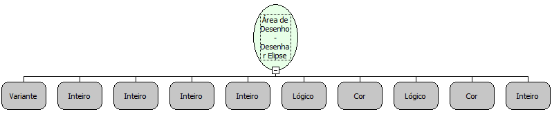

Descrição:

Desenha uma elipse na área de desenho passada como parâmetro.

Parâmetros:

1. Área de Desenho (Variante)

2. Coordenada X inicial.

3. Coordenada Y inicial.

4. Valor de A

5. Valor de B

6. Valor lógico que informa se a elipse será preenchida.

7. Cor de preenchimento.

8. Valor lógico que informa se a elipse será delineada.

9. Cor da Borda.

10. Espessura da borda.

Retorno:

Não possui.

Nome Real:

ebfCanvasDrawEllipse

Compatibilidade:

Cliente
