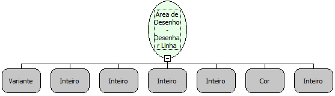

Descrição:

Desenha uma linha na área de desenho passada como parâmetro.

Parâmetros:

1. Objeto Área de Desenho;

2. Coordenada X inicial;

3. Coordenada Y inicial;

4. Coordenada X final;

5. Coordenada Y final;

6. Cor da linha;

7. Espessura da linha.

Retorno:

Não possui.

Nome Real:

ebfCanvasDrawLine

Compatibilidade:

Cliente
