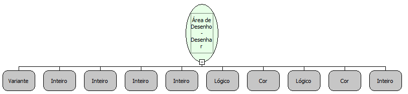

Descrição:

Desenha um losango na área de desenho passada como parâmetro.

Parâmetros:

1. Área de Desenho;

2. Coordenada X inicial;

3. Coordenada Y inicial;

4. Dimensão da diagonal 1;

5. Dimensão da diagonal 2;

6. Valor lógico que informa se o losango será preenchido;

7. Cor de preenchimento;

8. Valor lógico que informa se o losango será delineado;

9. Cor da borda;

10. Espessura da borda.

Retorno:

Não possui.

Nome Real:

ebfCanvasDrawRhombus

Compatibilidade:

Cliente
