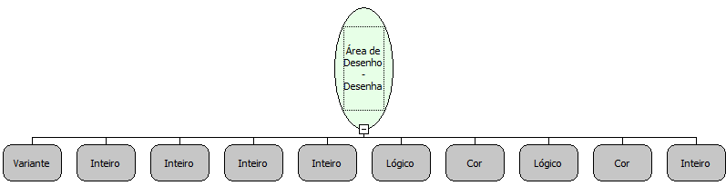

Descrição:

Desenha um retângulo na área de desenho passada como parâmetro.

Parâmetros:

1. Área de Desenho (Variante)

2. Coordenada X inicial.

3. Coordenada Y inicial.

4. Largura

5. Altura

6. Valor lógico que informa se o retângulo será preenchido.

7. Cor de preenchimento.

8. Valor lógico que informa se o retângulo será delineado

9. Cor da borda.

10. Espessura da borda

Retorno:

Não possui.

Nome Real:

ebfCanvasDrawRect

Compatibilidade:

Cliente
