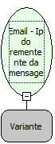

Descrição:

Obtém o remetente da mensagem passada como parâmetro

Parâmetros:

1. Mensagem (Função: Email -  Mensagens em uma pasta)

Retorno:

Ip do Remetente da mensagem

Nome Real:

ebfEmailGetMessageSenderIp

Compatibilidade:

Servidor
