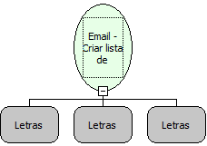

Descrição:

Cria uma lista de destinatários para o envio de email.

Parâmetros:

1. Destinatários "TO".

2. Destinatários "CC".

3. Destinatários "BCC".

Retorno:

Lista de destinatários.

Observações:

1. Os destinatários passados como parâmetros são separados por ","(Vírgula)

2. O retorno desta função é usado como parâmetro para funções de enviar email.

Nome Real:

ebfSMTPGetRecipientsAddress

Compatibilidade:

Servidor
