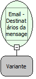

Descrição:

Retorna uma lista de destinatários da mensagem passada como parâmetro.

Parâmetros:

1. Mensagem (Função: Email -  Mensagens em uma pasta).

Retorno:

Lista de destinatários

Observação:

Para manipular o retorno desta mensagem é necessário o uso das FUNÇÕES DE LISTA.

Exemplos:

1ºParâmetro: Mensagem

Retorno: [Suporte@softwell.com.br,comercial@softwell.com.br]

Nome Real:

ebfEmailGetMessageListTo

Compatibilidade:

Servidor.
