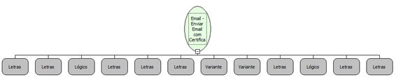

Descrição:

Envia uma mensagem instantaneamente para os destinatários.

Parâmetros:

1. Servidor

2. Porta

3. SSL?

4. Usuário

5. Senha

6. Remetente

7. Destinatários (Ver Observação 1)

8. Assunto

9. Mensagem

10. HTML?

11. Caminho do certificao

12. Senha do certificado

Observações:

1. Os destinatários podem ser passados separados por "," e serão enviados como "TO". Se for necessário enviar email como "TO", "CC" e/ou "BCC", é necessário utilizar a função "Email - Criar lista de destinatários".

2. Caso o 10º parâmetro seja Verdadeiro, a mensagem será renderizada como HTML, obedecendo a todas as regras da linguagem.

3. O envio de e-mails deve ser sempre feito a partir de um único modo de conexão (SSL ou sem SSL). Caso haja a troca do modo de conexão, é necessário reiniciar o servidor de aplicações. Esta é uma limitação da linguagem (Java).

Nome Real:

ebfSendAuthenticatedEmailWithCA

Compatibilidade:

Servidor
