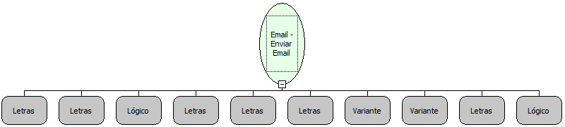

Descrição:

Envia uma mensagem instantaneamente para os destinatários.

Parâmetros:

1. Servidor

2. Porta

3. SSL?

4. Usuário

5. Senha

6. Remetente

7. Destinatários (Ver Observação 1)

8. Assunto

9. Mensagem

10. HTML?

Observações:

1. Os destinatários podem ser passados separados por "," e serão enviados como "TO". Se for necessário enviar email como "TO", "CC" e/ou "BCC", é necessário utilizar a função "Email - Criar lista de destinatários".

2. Caso o 10º parâmetro seja Verdadeiro, a mensagem será renderizada como HTML, obedecendo a todas as regras da linguagem.

3. O 6 º parâmetro, além do email do remetente, também pode ser informado o nome do mesmo. Para isso deve ser informado o nome que será mostrado e em seguida o email. O email deve ser envolvido por &lt;&gt;.

Exemplo:

Passando Nome e email: Carlos Santos &lt;carlos@testes.com&gt;

Passando apenas email: carlos@testes.com

Nome Real:

ebfSendAuthenticatedEmail

Compatibilidade:

Servidor
