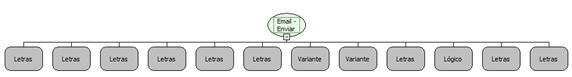

Descrição:

Envia uma mensagem instantaneamente para o(s) destinatário(s) utilizando certificado Digital.

Parâmetros:

1. Servidor

2. Porta

3. Tipo de Autenticação:

       1 - Sem SSL

       2 - Com SSL

       3 - Com TLS

4. Usuário

5. Senha

6. Remetente

7. Destinatários (Ver Observação 1)

8. Assunto

9. Mensagem

10. HTML?

11. Caminho do certificao

12. Senha do certificado

Observações:

1. Os destinatários podem ser passados separados por "," e serão enviados como "TO". Se for necessário enviar email como "TO", "CC" e/ou "BCC", é necessário utilizar a função "Email - Criar lista de destinatários".

2. Caso o 10º parâmetro seja Verdadeiro, a mensagem será renderizada como HTML, obedecendo a todas as regras da linguagem.

3. O envio de e-mails deve ser sempre feito a partir de um único modo de conexão (SSL, TLS ou Sem SSL). Caso haja a troca do modo de conexão, é necessário reiniciar o servidor de aplicações. Esta é uma limitação da linguagem (Java).

4. O Servidor SMTP do Hotmail só aceita conexões TLS.

5. O 6 º parâmetro, além do email do remetente, também pode ser informado o nome do mesmo. Para isso deve ser informado o nome que será mostrado e em seguida o email. O email deve ser envolvido por &lt;&gt;.

Exemplo:

Passando Nome e email: Carlos Santos &lt;carlos@testes.com&gt;

Passando apenas email: carlos@testes.com
