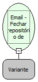

Descrição:

Fecha o repositório de emails

Parâmetros:

1. Repositório de emails (Função: Email - Repositório de emails)

Exemplos:

1º Parâmetro: Repositório de emails

Nome Real:

ebfEmailCloseStore

Compatibilidade:

Servidor
