Descrição:

A partir do ponto em que se define a função "Monitorar Exceções", os erros serão monitorados e poderão ser capturados nesta função. Uma função depende da outra, portanto ao usar "Capturar" é obrigado o uso da "Monitorar".

Parâmetros:

1. Fluxo que deve ser executado em caso de ocorrência de exceções. Este fluxo automaticamente receberá por parâmetro de entrada as seguintes informações, em ordem:

    1. Mensagem da exceção

    2. Causa da exceção

    3. Exceção (Objeto)  -> Apenas Servidor

    4. Servidor (java.lang.Exception)

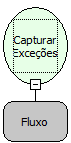

Observação:

Pelo fato de o controle do erro ser do desenvolvedor, o fluxo não será interrompido. Este continuará com sua normal execução.

Nome Real:

ebfCatch

Compatibilidade:

Cliente e Servidor

# Exemplo de Uso das Funções Try e Catch

O objetivo das funções "Try" e "Catch" é tratar exceções (mensagens de erro, por exemplo) geradas pela execução de fluxos de ações.

Estrutura básica do uso do Try Catch:

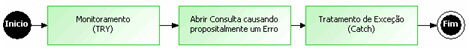

Criando um Novo Fluxo (Tratamento Exceção), salve com o Destino Servidor. Defina o Identificador (variáveis):

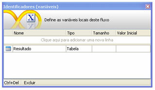

1. Insira um 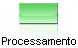 para monitoramento de todas as exceções (TRY). A partir desse ponto, qualquer exceção gerada não irá interromper o andamento da execução do fluxo de ação. Esse erro será tratado de acordo com o que for definido posteriormente. No Montador de Expressão, na aba Fluxos e Funções, localize a função Monitorar Exceção:

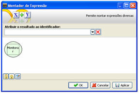

2. Insira um  para constar a ação que deverá ser executada e que pode causar erro. Neste exemplo, será usada uma consulta em uma tabela (tab_Cidade) inexistente na base de dados na qual está contido o projeto. No Montador de Expressão, na aba Fluxos e Funções, localize a função Abrir Consulta:

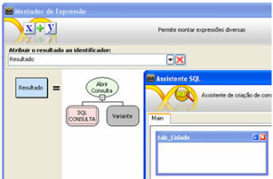

3. Insira um  para tratamento da exceção (Catch), caso o erro ocorra. A função Capturar Exceções recebe como parâmetro um fluxo (Exceção), que será selecionado como parâmetro e deverá conter todo o tratamento necessário para contornar o problema. No Montador de Expressão, na aba Fluxos e Funções, localize a função Capturar Exceções:

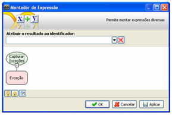

Esse fluxo está pronto.

É necessário criar o fluxo Exceção que foi selecionado como parâmetro da função "Capturar Exceções":

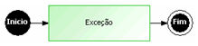

1. Criando um Novo Fluxo (Exceção), salve com o Destino Servidor. Defina os Parâmetros de Entrada:

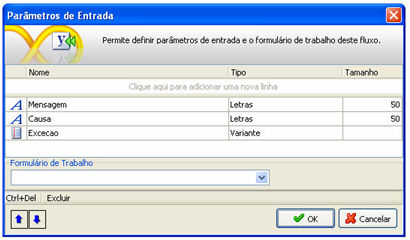

Observação: Esses parâmetros de entrada serão preenchidos automaticamente pelo Webrun no momento da execução do fluxo de ação principal.

2. Insira um  para mostrar, por meio de uma mensagem de alerta, o conteúdo dos parâmetros de entrada recebidos automaticamente. No Montador de Expressão, na aba Fluxos e Funções, localize a função Alertar Aguardando Ok:

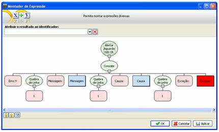

Esse fluxo está pronto.

Com o formulário criado e associado ao fluxo Tratamento Exceção no componente botão Executar, acesse no ambiente *Webrun* a tela:

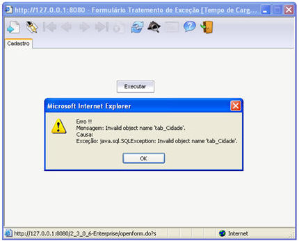
