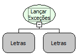

Descrição:

Lança uma exceção

Parâmetros:

1. Mensagem da exceção

2. Causa da exceção (Opcional)

Retorno:

Não possui.

Observação:

Caso essa função seja usada dentro das funções "Monitorar Exceções" e "Capturar Exceções", então as informações chegarão no fluxo definido em "Capturar Exceções".

Nome Real:

ebfThrowException

Compatibilidade:

Cliente e Servidor
